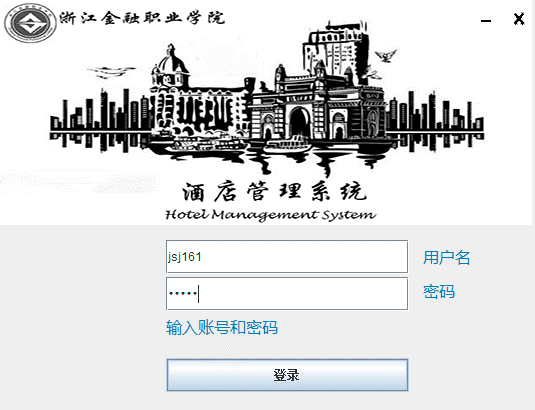
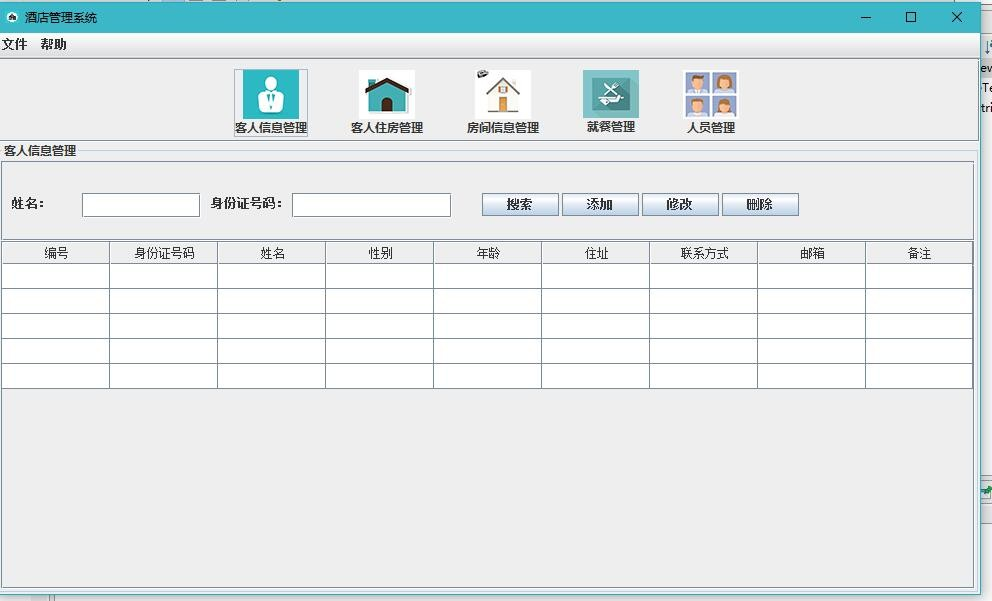
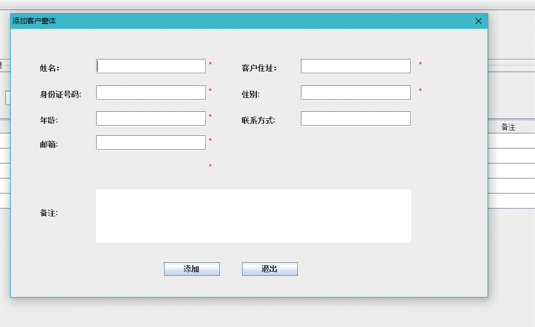

# Hotel Management System（酒店管理系统）

A Java Swing desktop app for managing hotel guest records, built as a small distributed system: a login server that issues session tokens, an RMI service that does the database work, and a Swing client.

## Architecture

```
Swing client ──(1) socket: username + password ─────────▶ Auth server ──JDBC──▶ SQL Server
             ◀─ session token ──────────────────────────          │
             ──(2) RMI call + token ────────────────────▶ Guest service (RMI) ──JDBC──▶
```

1. **Login over a socket.** The client sends a serialised `User` object to the auth server on port 12345. The server checks it against `tb_users` and returns a 16-character token (from a UUID), `Failed`, or `login` if that user already has a live session.
2. **Token-checked RMI calls.** The guest service is an RMI object registered on port 12346. Every method takes the token and throws `TokenUnvalidException` if it is not valid, so a client cannot read or change data without logging in.
3. **Session expiry.** `TokenManager` is a singleton holding token maps in synchronised hash tables. A background thread removes tokens older than the timeout in `server.properties` (180 s by default) and refreshes the server window.
4. **Server monitor.** The server window lists online users, their tokens, time logged in and time left, plus the current user count and memory use.

## Features

- Login window with custom drawing and drag-to-move.
- **Guest management:** add, edit, delete and list guests (ID number, name, sex, age, address, phone, email, notes), and search by name, ID number or both.
- Guest management is the implemented module. Empty panels for room bookings and purchasing exist in the code but were never wired into the main window.

## Stack

Java, Swing, Java RMI, sockets with object streams, JDBC, Microsoft SQL Server, Eclipse

## Run it

1. Attach `database/hotel.mdf` in SQL Server Management Studio (database name `hotel`, tables `tb_users` and `tb_supplier`).
2. Set the database password in `hotel-auth-server/src/common/util/server.properties`, and in the `HOTEL_DB_PASSWORD` environment variable.
3. Import `hotel-auth-server` and `hotel-client` into Eclipse, add the SQL Server JDBC driver (`sqljdbc41.jar`) to the server's build path.
4. Run `server.view.server` in `hotel-auth-server`, then `user.Client` in `hotel-client`.

## Layout

```
hotel-auth-server/src/
  server/          auth socket server, TokenManager, DB connection, server window
  supplier/        guest bean, DAO interface and JDBC implementation (RMI service)
  user/            user bean
  common/util/     server.properties (ports, token timeout, DB settings)
hotel-client/src/
  user/            entry point, login window
  common/view/     main window and custom Swing components
  supplier/        guest list, add and edit windows (the package name is left over from an earlier version)
database/hotel.mdf
screenshots/
```

## Screenshots

| Login | Main window | Guest records |
|---|---|---|
|  |  |  |
