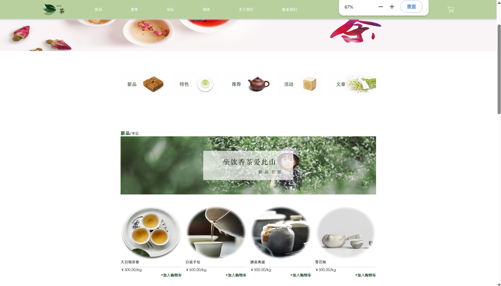
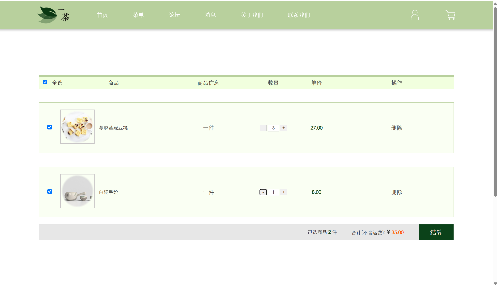

# YiCha Tea Website（一茶）

A brand website for a tea shop, built twice: first as a hand-coded static site, then rebuilt as a dynamic site on the DedeCMS content management system so products and articles could be managed from an admin panel.

| Static site | CMS site |
|---|---|
|  |  |

## Static site（`static/`）

Nine hand-written pages: home, product list, product detail, cart, login, about us, news list, article detail and an information page.

- **Home carousel:** images rotate every 3.5 seconds (`js/index.js`).
- **Product detail:** hovering a thumbnail swaps the main image (`js/details.js`, jQuery).
- **Cart:** select all or invert selection, plus and minus buttons per item, and subtotals and the order total recalculated on every change (inline jQuery in `webs/car.html`). Cart items are fixed sample data; there is no backend.
- **About us:** custom city drop-down menu.
- **Contact us** (in the navigation bar): asks for a name and email with `prompt()` and confirms with an alert.

Layouts are fixed-width (1200px), built with hand-written CSS per page.

## CMS site（`cms-templates/`）

The same design turned into DedeCMS templates, so the home page, product lists and articles are filled from the CMS database instead of hard-coded HTML.

- **Templates:** home, header and footer, login, three product category lists (tea, cakes, cups), a product detail page, news and information lists, five article layouts and image gallery pages.
- **Template tags:** `{dede:include}` for the shared header and footer, `{dede:arclist}` and `{dede:articlelist}` for product and article lists, `{dede:field}` and `{dede:global}` for page content, `{dede:prenext}` for previous and next links.
- Each template has its own stylesheet in `cms-templates/images/`.

Only the templates, styles and images written for this site are included here. The DedeCMS core and the site's database are not. The templates were originally GB2312-encoded and have been converted to UTF-8 for reading on GitHub; internal links point to the original local install at `http://localhost/tea/`.

## Stack

HTML, CSS, JavaScript, jQuery, DedeCMS (PHP, MySQL)

## Run it

- **Static site:** open `static/webs/index.html` in a browser.
- **CMS templates:** install DedeCMS 5.7 at `http://localhost/tea/`, copy `cms-templates/` into `templets/default/`, then create the channels and articles in the admin panel.
