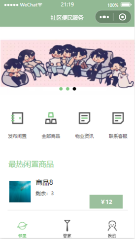
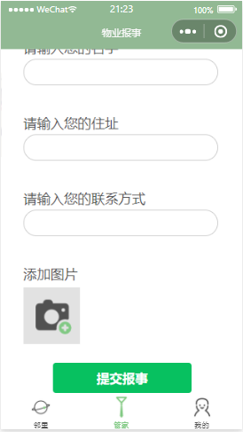
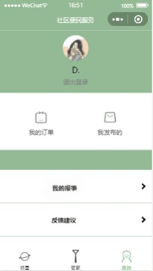

# Community Service Mini Program（社区便民服务小程序）

A WeChat Mini Program for a residential community: residents list and buy second-hand goods from neighbours, read property-management news, find property contacts, and submit repair requests or complaints. It runs entirely on WeChat Cloud Development (cloud database, cloud storage and cloud functions), so there is no separate server.

## How it works

- **Identity.** On launch, `app.js` calls the `getOpenid` cloud function and caches the user's openid. Buying and the "Mine" lists also need a WeChat profile, requested with `wx.getUserProfile`.
- **Listings.** Goods are documents in the `goods` collection. The client publishes them directly (images go to cloud storage first); reads go through `getGoodList`, which only returns goods with status `上架` (on sale) and stock above 0.
- **Cart and checkout.** The cart is kept in local storage. Checkout writes one `order` document per item and then calls `addXiaoLiang` with negative quantities to decrement stock. **Payment is simulated:** the pay sheet shows "WeChat Pay", but no payment API is called.
- **Order lifecycle.** Status `0` = placed, `1` = received, `-1` = cancelled. A buyer can confirm receipt or cancel (cancelling puts the stock back via `addXiaoLiang`); a seller can mark an order as delivered via `changeGood`.

## Features

| Page | What it does |
|---|---|
| `index` (邻里 tab) | Banner from `lunbotu`, shortcuts, and featured goods (`tuijian: true`) |
| `mall` | All goods grouped by category, with a scroll-linked side menu and a cart |
| `detail` | One listing with image preview and add-to-cart |
| `pay` | Pick a WeChat shipping address, add a note, place the order (simulated payment) |
| `fabu` | Publish a listing: name, price, quantity, category, description, up to 8 photos |
| `news` | Property news with paged loading; tapping an item increments its view count |
| `kefu` | Property contacts from `huishou`: call or copy WeChat ID |
| `guanjia` (管家 tab) | Repair or complaint form with photos, saved to `baoshis` |
| `mine` (我的 tab) | Profile, links to orders, listings and reports, feedback and customer-service buttons |
| `myorder` | Buyer's orders in tabs: to receive, completed, cancelled |
| `mysell` | Seller's listings (with delete) and orders to deliver or completed |
| `mybaoshi` | Submitted repair and complaint reports |

## Cloud functions

| Function | Purpose |
|---|---|
| `getOpenid` | Returns the caller's openid |
| `getGoodList` | Goods queries: featured, newest, search by name, the caller's own listings, or all on sale |
| `addXiaoLiang` | Increments or decrements `num` (stock) for a list of goods |
| `changeGood` | Deletes a listing, or marks an order as delivered |
| `getOrderList` | Orders for the buyer or for the seller, filtered by status |
| `getchudiList` | Paged read of `news` |
| `newsUpList` | Increments a news item's `hits` |
| `baoshiGetList` | Reads `baoshis` |

## Database collections

`goods`, `order`, `news`, `huishou`, `baoshis`, `lunbotu`

## Stack

WeChat Mini Program (WXML, WXSS, JavaScript, WXS), WeChat Cloud Development (cloud database, cloud storage, Node.js cloud functions with `wx-server-sdk`)

## Run it

1. Open the project folder in WeChat DevTools. Cloud development needs a real AppID, so replace `touristappid` in `project.config.json` with your own.
2. Create a cloud environment and put its ID in place of `your-cloud-env-id` in `miniprogram/app.js` and `miniprogram/envList.js`.
3. In the cloud console, create the six collections listed above. Add a few `news`, `huishou` and (optionally) `lunbotu` documents by hand; the app creates the rest. Set permissions so users can read all goods and news.
4. Right-click each folder under `cloudfunctions/` and choose "Upload and deploy: install dependencies in the cloud".
5. Compile and run in the simulator.

## Layout

```
miniprogram/
  app.js, app.json   cloud init, openid, address helpers; pages and tab bar
  pages/             the pages in the table above
  utils/filter.wxs   date formatting for templates
  images/            icons and tab-bar images
cloudfunctions/      the eight cloud functions above
screenshots/
```

## Screenshots

| Neighbourhood | Property services | Mine |
|---|---|---|
|  |  |  |
