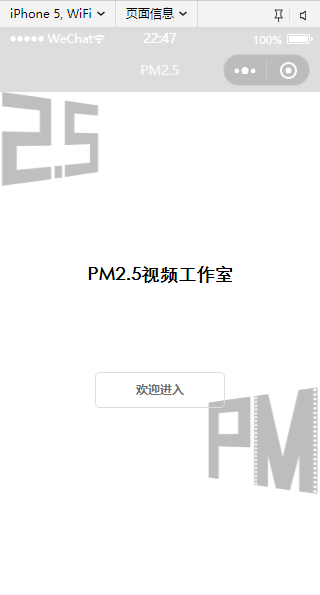
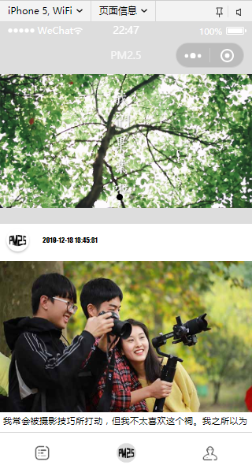
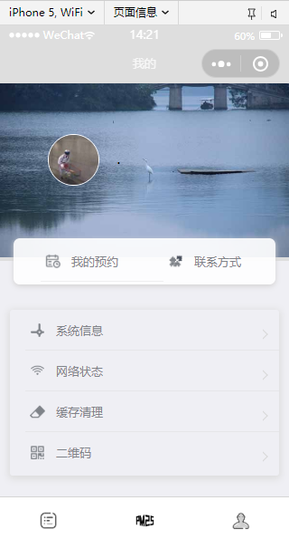
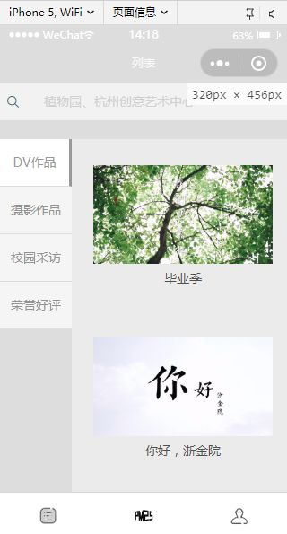
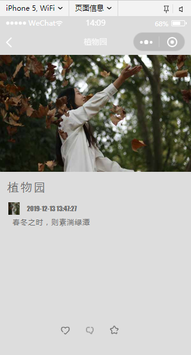
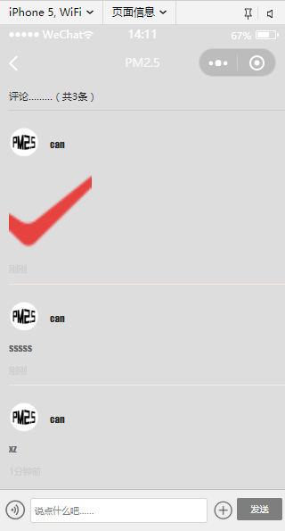

# PM2.5 Studio Mini Program（PM2.5 视频工作室小程序）

A WeChat Mini Program that showcases the work of PM2.5, a student digital-media studio: DV videos, photography, campus interviews and awards, plus a feed of studio articles with comments. Works and articles come from a hosted shop/CMS backend (it120 "API 工厂") over HTTP; comments are kept on the device.

## How it works

- **Remote content.** The base URL `https://api.it120.cc/caidanni` is set in `app.js` (`globalData`). Works are stored there as shop "goods" in four categories, and articles as CMS news items. Pages fetch them with `wx.request`.
- **Local comments.** On first launch `app.js` seeds local storage (`postList`) from `data/data.js`. `db/DBPost.js` wraps that storage: it reads a post's comments, sorts them newest first and appends new ones. Comment threads exist only for the post IDs seeded there.

## Features

- **Welcome page** with the studio logo; the enter button opens the Articles tab.
- **Works tab** (`pages/index`): category sidebar (DV works, photography, campus interviews, awards) that loads `/shop/goods/list?categoryId=...`; tapping a work opens its detail page (`/shop/goods/detail`) with title and image.
- **Articles tab** (`pages/post`): banner carousel and an article list from `/cms/news/list`; the detail page shows the cover, title, date and summary.
- **Comments** (`pages/post/post-comment`): text comments, up to three photos from the album or camera, and hold-to-record voice comments with playback.
- **Me tab** (`pages/login`): WeChat avatar and nickname via `open-data`, device info (model, OS, WeChat version, permissions, screen), network type, clear local cache, and QR-code scanning.
- The "My bookings" entry opens a placeholder page; there is no booking feature. Like and favourite icons on the article page are not wired up.

## Stack

WeChat Mini Program (WXML, WXSS, JavaScript, WXML templates), `wx.request` against the it120 API backend, `wx.setStorageSync` for local data

## Run it

1. Open the project folder in WeChat DevTools. The AppID is `touristappid`, so it runs in the simulator without a registered account.
2. Keep "Do not verify request domains" enabled (`urlCheck: false` in `project.config.json`) so requests to `api.it120.cc` go through.
3. Compile. Works and articles appear only while the it120 backend still serves that account's data.

## Layout

```
app.js, app.json     API base URL, storage seeding; pages and tab bar
pages/
  welcome/           entry page
  index/             works by category, index-detail/ for one work
  post/              article list, post-detail/, post-comment/, post-item/ template
  login/             "Me" tab, device/ (system info), myorder/ (placeholder)
db/DBPost.js         local-storage wrapper for posts and comments
data/data.js         seed data for local comments
util/util.js         request helper and relative-time formatting
images/              logos, icons, tab-bar images
screenshots/
```

## Screenshots

| Entry | Articles | Me |
|---|---|---|
|  |  |  |

| Works | Work details | Comments |
|---|---|---|
|  |  |  |
